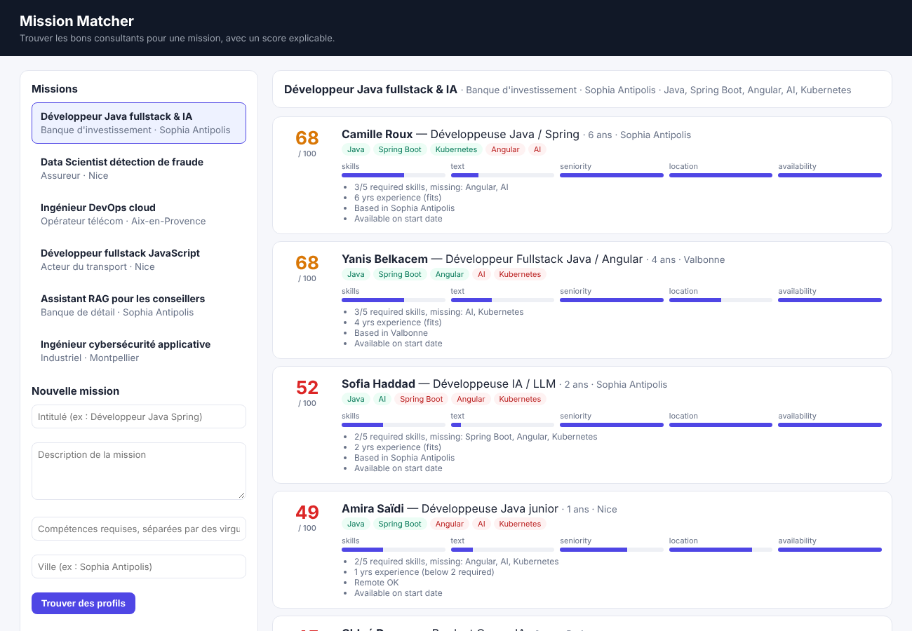

# Mission Matcher — staffing consultants ↔ missions

**Trouver en quelques secondes les consultants les plus adaptés à une mission client, avec un score expliqué.**

Projet réalisé par Dhia Kanzari autour d'un enjeu central des sociétés de conseil IT : le *staffing*. Quand une nouvelle mission arrive, les business managers doivent comparer vite des dizaines de profils (compétences, séniorité, localisation, disponibilité). Mission Matcher automatise ce premier tri et montre **pourquoi** chaque profil est proposé, pour que la décision reste humaine.



## Comment le score est calculé (0–100)

| Critère | Poids | Détail |
|---|---|---|
| Compétences requises | 45 % | part des compétences de la mission présentes dans le profil, avec synonymes (Spring Boot = Spring, ReactJS = React, ML = Machine Learning…) |
| Similarité du texte | 25 % | TF-IDF + similarité cosinus entre la description de mission et le profil (titre, compétences, résumé), FR/EN, sans accents ni mots vides |
| Séniorité | 15 % | pénalité si en dessous du minimum, plus légère si largement au-dessus |
| Localisation | 10 % | même ville, ou télétravail accepté des deux côtés |
| Disponibilité | 5 % | décroît avec le nombre de jours après la date de démarrage |

Chaque résultat liste les compétences trouvées et manquantes et les raisons du score : un business manager voit tout de suite qu'un profil est excellent techniquement mais disponible un mois trop tard.

## Lancer

Java 21, **aucune dépendance externe** (serveur HTTP du JDK, parseur JSON maison) :

```bash
./build.sh test                     # compile, lance les 15 tests, crée le jar
java -jar build/mission-matcher.jar # http://localhost:8080
```

Les données d'exemple (16 consultants, 6 missions, entièrement fictives) sont dans `data/`.

## API

| Méthode | Endpoint | Description |
|---|---|---|
| GET | `/api/missions` | missions |
| GET | `/api/consultants` | consultants |
| GET | `/api/missions/{id}/matches?top=5` | meilleurs profils pour une mission |
| POST | `/api/match?top=5` | classer les profils pour une mission envoyée en JSON |

```bash
curl -X POST localhost:8080/api/match -d '{"title":"Dev React","description":"front React, API Node","skills":["React","Node.js"],"city":"Nice"}'
```

## Pistes

- Embeddings sémantiques (modèle de langage) à la place du TF-IDF pour comprendre les reformulations.
- Import des CV (PDF) et des fiches mission depuis l'outil RH / CRM.
- Apprentissage des poids à partir des staffings validés par les managers.
- Portage Spring Boot + base de données pour un usage multi-utilisateurs.

## Structure

```
src/main/java/io/dhia/matcher/
  Matcher.java     score et explications
  TextIndex.java   tokenisation FR/EN, synonymes, TF-IDF, cosinus
  App.java         API REST + interface (com.sun.net.httpserver)
  Json.java        parseur / sérialiseur JSON
  Model.java       Consultant, Mission
src/test/java/...  tests (sans framework)
```

Licence MIT — Dhia Kanzari
